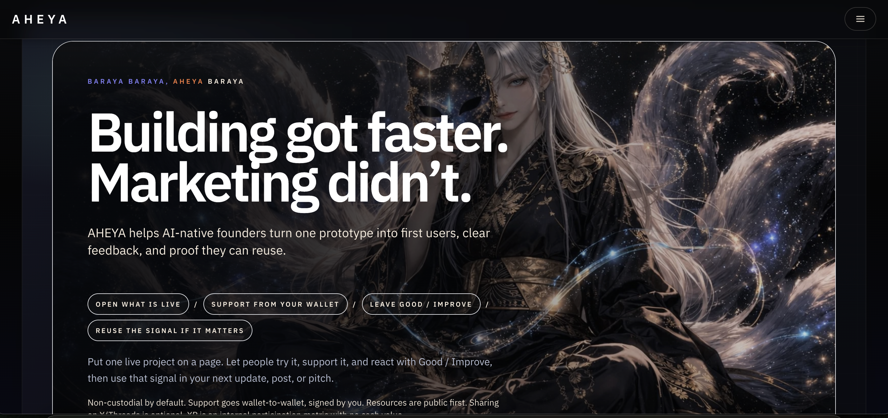
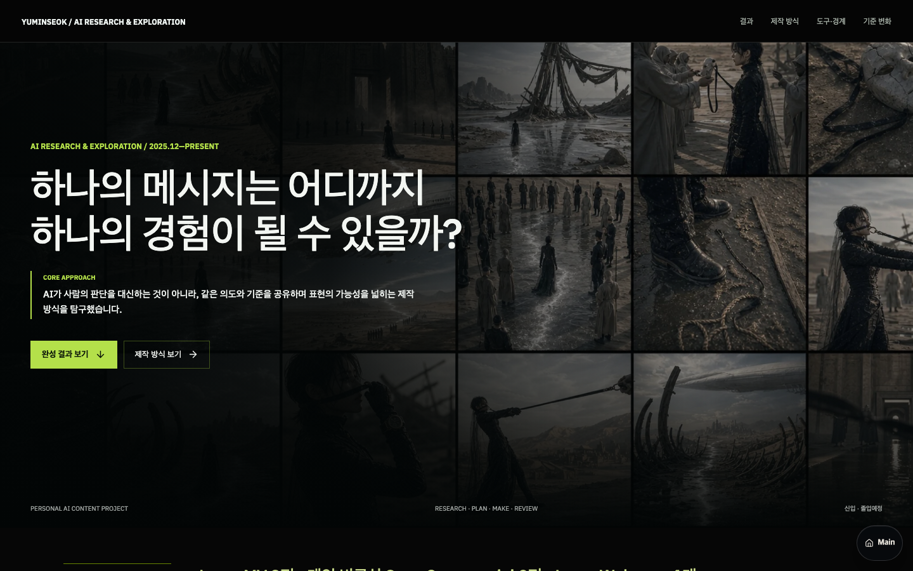

# AX 포트폴리오 공개 근거

유민석의 포트폴리오에서 확인할 수 있는 공개 화면, 구현 기록, 연동 명세를 모았습니다.

## AHEYA

창작자 프로젝트의 후원과 피드백을 다룬 서비스입니다. 화면은 운영 당시 홈의 공개 보관 이미지입니다.

| 확인할 내용 | 공개 근거 |
| --- | --- |
| 보관된 서비스 기능 및 구현 범위 | [기능 기록](https://github.com/aheyabaraya/aheya-public-archive/blob/884a65e23e256b5738b3f3101b3bf1345b527dd9/docs/public-archive/FEATURES.md) |
| 인증과 후원 거래의 구조 | [서비스 구조](https://github.com/aheyabaraya/aheya-public-archive/blob/884a65e23e256b5738b3f3101b3bf1345b527dd9/docs/public-archive/ARCHITECTURE.md) |
| 외부 프로그램이 연동하는 방법 | [Trust API 명세](https://github.com/aheyabaraya/aheyabaraya-trust-public/blob/9ac30d359a3937a611a96b438c4cd856241e12a9/docs/trust/README.md) |
| 검증 가능한 공개 구현 예제 | [보안·구현 예제](https://github.com/aheyabaraya/aheya-public-evidence/tree/3f27b37c434a2bac63a18615a9d2e526c94d1dd3) |
| 화면 캡처의 원본 | [공개 홈 이미지](https://portfolio-yuminseoks-projects.vercel.app/aheya/aheya-home-hero.webp) |

## IDOL · 콘텐츠 제작 파이프라인

개인 콘텐츠 제작의 공개 결과와 제작 방식은 기존 AI Exploration 포트폴리오에서 확인할 수 있습니다.

| 확인할 내용 | 공개 근거 |
| --- | --- |
| 공개 포트폴리오와 제작 방법 | [AI Exploration](https://portfolio-yuminseoks-projects.vercel.app/ai-exploration) |
| 2026-11-25 공개 페이지 화면 | [사이트 캡처](screenshots/idol-public-page.png) |
| INK 제작 결과 | [편집 구간의 제작 스틸](screenshots/idol-ink.jpg) · [공개 원본](https://portfolio-yuminseoks-projects.vercel.app/ai-exploration/iteration/evolution/ink-final-window-130-142-poster.jpg) |
